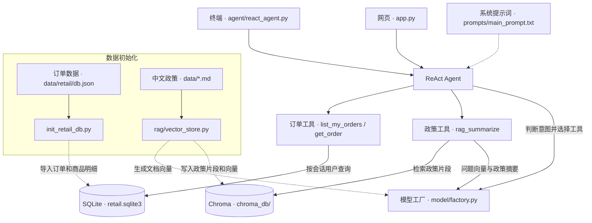

# 零售售后 Agent

一个基于 LangChain 和 LangGraph 的中文零售售后助手。用户可以查询自己账号下的订单和商品明细，也可以询问取消、修改、退货和换货政策。对于「这笔订单怎么退」这类问题，Agent 先查 SQLite 里的订单状态，再从 Chroma 检索适用的政策。

项目使用模拟账号和只读订单库，适合本地演示。取消、修改、退货和换货属于政策咨询范围，订单状态由演示数据提供。

## 工具

| 工具 | 调用场景 | 返回内容 |
| --- | --- | --- |
| `list_my_orders()` | 查看自己的订单，或忘记订单号 | 当前会话账号的订单号和状态 |
| `get_order(order_id)` | 查指定订单的状态和商品明细 | 订单状态、商品名称、规格和价格 |
| `rag_summarize(query)` | 询问通用售后政策，或结合订单状态了解办理条件 | 从中文政策库检索资料后生成的摘要 |

模拟用户 ID 由终端输入或 Streamlit 侧边栏设置，通过会话上下文交给订单工具。SQLite 查询同时匹配用户 ID 和订单号，模型调用工具时只传订单号。终端使用 LangGraph 的内存检查点保存本次对话，补发订单号后可以继续查询。

## 快速开始

以下命令在包含 `app.py` 的项目根目录执行。核心流程已在 Python 3.14.9 环境验证。

### 1. 安装依赖

```bash
python -m venv .venv
source .venv/bin/activate
python -m pip install langchain langchain-core langchain-community langchain-openai \
  langchain-chroma langchain-text-splitters langgraph pyyaml
```

### 2. 配置模型

在 `config/rag.yml` 填写模型和接口配置。聊天模型需要通过 OpenAI 兼容接口支持工具调用。向量模型使用阿里云百炼的 `qwen3-vl-embedding`，通过 HTTP API 生成文本向量。

```yaml
chat_model_name: "your-tool-calling-model"
chat_model_api_key: "your-chat-api-key"
chat_model_url: "https://your-provider.example/v1"

embedding_model_name: "qwen3-vl-embedding"
embedding_model_api_key: "your-bailian-api-key"
```

将示例值替换为自己的模型配置，分享项目时使用占位符保留配置结构。

### 3. 初始化订单库和政策索引

```bash
python init_retail_db.py
python -m rag.vector_store
```

订单初始化脚本从 `data/retail/db.json` 生成 `data/retail/retail.sqlite3`，导入 1,000 笔订单和 2,978 条商品明细。已有订单时会跳过导入。

政策索引脚本读取 `data/` 下的六份中文 Markdown 文档，将文本切分、向量化并写入 `chroma_db/`。`md5.text` 记录已索引文件的内容哈希，再次运行时会跳过内容相同的文件。新增文档后可直接再运行索引脚本。修改或删除旧政策后，如需清理旧片段，将 `chroma_db/` 和 `md5.text` 一起移出项目目录，再运行索引命令。

### 4. 启动对话

```bash
python -m agent.react_agent
```

看到「模拟用户 ID」时直接回车，使用默认账号 `sophia_garcia_1101`。输入 `exit` 或「退出」结束会话。若要使用网页界面，安装 Streamlit 后启动应用。

```bash
python -m pip install streamlit
python -m streamlit run app.py
```

网页通过侧边栏设置账号。提问时带上完整订单号和要查询的事项，便于每次请求独立处理。

## 演示问题

以下示例使用默认账号 `sophia_garcia_1101`。

| 输入 | 预期行为 |
| --- | --- |
| 我忘了订单号，帮我列出我的订单。 | 查到 `#W1023987` 和 `#W8727985`，两笔都已签收。 |
| `#W1023987` 里买了哪些商品？ | 查到行李箱套装和宠物床。 |
| 我想退 `#W1023987` 里的宠物床，需要怎么做？ | 先核对签收状态和商品，再检索退货政策，说明退款方式和寄回流程。 |
| 帮我查 `#W2611340` 的状态。 | 默认账号查不到该订单。切换到模拟账号 `james_li_5688` 后可查到状态 `processed`。 |

也可以在终端先问「我的订单签收了吗」，等 Agent 追问后只发送 `#W1023987`，验证多轮查询。

## 项目结构



| 位置 | 职责 |
| --- | --- |
| [agent/react_agent.py](agent/react_agent.py) | 组装 ReAct Agent、工具和会话上下文，提供终端入口 |
| [agent/tools/agent_tools.py](agent/tools/agent_tools.py) | 定义订单查询和政策检索工具 |
| [rag/vector_store.py](rag/vector_store.py) · [rag/rag_service.py](rag/rag_service.py) | 政策入库、向量检索和摘要 |
| [model/](model/) · [config/](config/) | 聊天模型和向量模型的创建、HTTP 封装与项目配置 |
| [prompts/](prompts/) | Agent 工具规则与政策摘要提示词 |
| [init_retail_db.py](init_retail_db.py) · [app.py](app.py) | SQLite 初始化脚本与 Streamlit 网页入口 |

## 数据来源

演示订单和英文政策来自 Sierra Research 的 τ²-bench Retail 数据，中文政策由英文政策翻译并按主题拆分。数据目录保留了英文原文和 MIT 许可证。[上游订单数据](https://github.com/sierra-research/tau2-bench/blob/main/data/tau2/domains/retail/db.json) · [上游政策](https://github.com/sierra-research/tau2-bench/blob/main/data/tau2/domains/retail/policy.md) · [数据许可证](data/retail/LICENSE)
